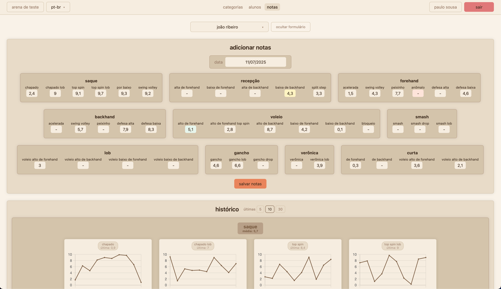

# grade tracker

track student grades across categories and subcategories, with per-subcategory line charts



## stack

- **backend**: python, flask, sqlalchemy, sqlite; pytest for tests
- **frontend**: vue 3 (script setup), vite, vue-router, vue-i18n, chart.js; vitest for tests
- **infra**: docker, nginx (reverse proxy, rate limiting, static file serving)

## run (local)

```bash
cd backend && uv sync
cd frontend && npm install
```

```bash
cd backend && uv run python run.py   # http://localhost:5000
cd frontend && npm run dev           # http://localhost:5173
```

open http://localhost:5173

## run (docker)

```bash
docker compose up --build # always rebuilds it
docker compose down -v    # stops and deletes volumes
```

open http://localhost

## config

if no `.env` is configured, the app uses insecure public defaults values.
to set your own values, copy `.env.example` to `.env` and edit it:

```bash
cp .env.example .env
```

`ADMIN_PASS` is only read when db is built.

## env vars

| var                     | default             | used in                                                    |
|-------------------------|---------------------|------------------------------------------------------------|
| `SECRET_KEY`            | `dev-default-value` | flask session signing                                      |
| `ADMIN_PASS`            | `admin pass`        | initial admin password (set on first run)                  |
| `SEED_PASS`             | `seed pass`         | password of every seeded user                              |
| `SESSION_COOKIE_SECURE` | `0`                 | `1` sends the session cookie only over https               |
| `FLASK_HOST`            | `127.0.0.1`         | flask bind address; set to `0.0.0.0` in docker via compose |
| `FLASK_DEBUG`           | `1`                 | reloader and debugger; set to `0` in docker via compose    |
| `DATABASE_URL`          | `backend/app.db`    | sqlalchemy db url; docker points it to the `/data` volume  |

## roles

| role    | lands on              | can do                                                        |
|---------|-----------------------|---------------------------------------------------------------|
| admin   | `/admin`              | create and delete teacher accounts, change own password, seed |
| teacher | `/teacher/categories` | manage categories, students, and grades                       |
| student | `/student`            | view own grades as charts                                     |

default admin account: `admin` / `admin pass`; password can be changed from the admin screen.

seed button: wipes db except `admin`, then creates demo data; all seeded users log in with `SEED_PASS`.

## entities

- **category**: top-level grouping (e.g. serve)
- **subcategory**: belongs to a category (e.g. strength); each gets its own line chart
- **grade**: value 0.0–10.0 with one decimal, tied from a teacher to a student + subcategory + date

## test

```bash
cd backend && uv run pytest
cd frontend && npm test
```

## codebase guides

- [FRONT_BASICS.md](FRONT_BASICS.md): frontend concepts from scratch
- [BACK_READ.md](BACK_READ.md), [FRONT_READ.md](FRONT_READ.md) and [INFRA_READ.md](INFRA_READ.md): beginner guides
- [TODO.md](TODO.md): known improvements and future work
